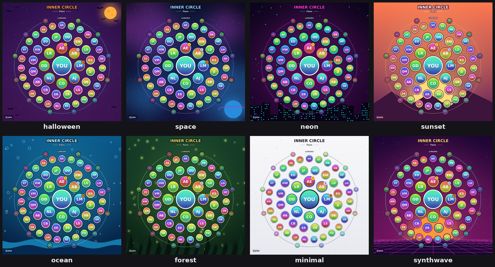
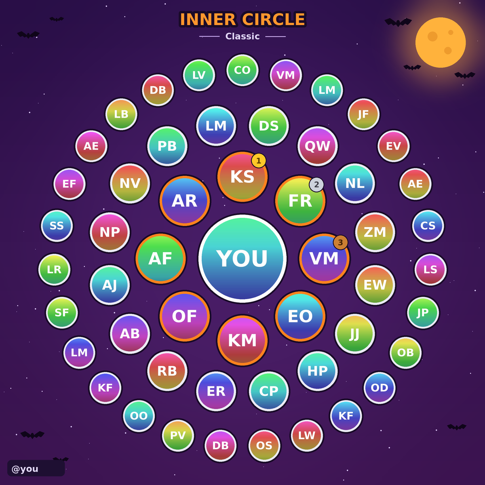
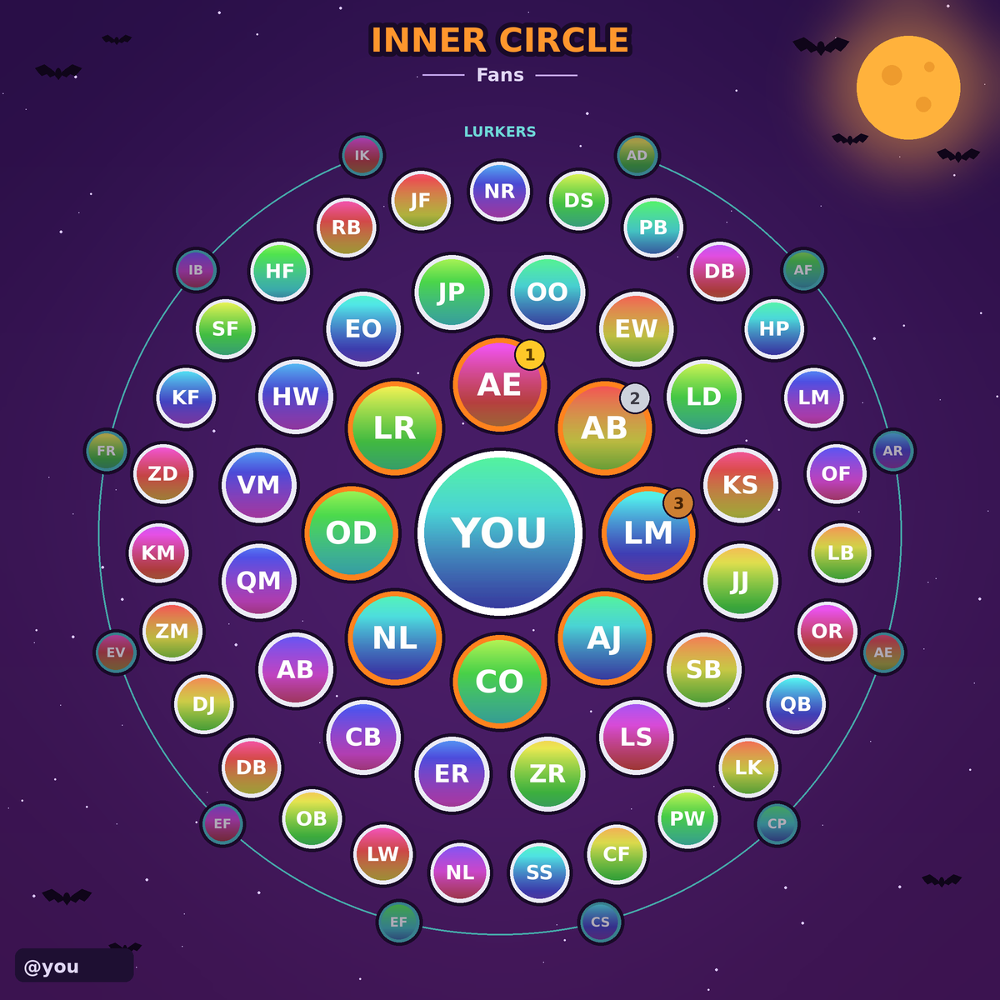
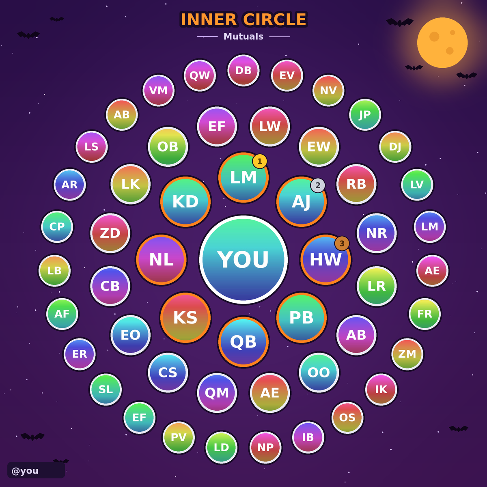

# True Circle

By [@JayDook](https://x.com/JayDook).

True Circle makes an "inner circle" picture for an X account. It shows rings of the people you actually talk with, with the closest ones in the middle. It ranks by real conversations, not likes.



| Classic | Fans | Mutuals |
|---|---|---|
|  |  |  |

*The examples use made-up accounts, not real people.*

## How scoring works (short version)
`score.py` reads saved X API result pages and groups posts into conversations.
- **classic** (default): 3 points per two-way conversation, 1.5 per one-way conversation, plus 1 per day you interacted. There is a small capped bonus for quotes, mentions and likes.
- **fans**: people who engage with you, whether or not you reply. It counts their replies and active days, plus the top posts of yours they liked. People who only liked your posts go into a separate "Lurkers" list.
- **mutuals**: only real back-and-forth counts (two-way conversations and shared days).

The excluded handles (`--exclude`) are removed from the list. Use this for brands and big accounts you don't want in the picture.

## Install
```bash
pip install -r requirements.txt   # just Pillow
```

## Usage
1. Save the raw JSON result pages from the X API as `*.txt` files:
   - `data/`: your posts and replies, plus posts that mention or reply to you (search results, posts by ids)
   - `likes/`: posts you liked
   - for fans, optionally `likers/<post_id>.txt`: the liking-users pages for your top posts
2. Score them:
```bash
python3 score.py --me <your_numeric_user_id> --data data --likes likes --exclude excl.json --out out
python3 score.py --me <id> --data data --likes likes --flavor fans --likers likers --out out_fans
python3 score.py --me <id> --data data --likes likes --flavor mutuals --out out_mutuals
```
   This writes `out/list.json` (you first, then the ranked accounts), `evidence.json` (why each person ranked where they did) and, for fans, `lurkers.json`.
3. Put the avatars next to `list.json` as `<username>.jpg`. The `img` URLs in `list.json` are where to download them from. Then render:
```bash
python3 render.py --list out/list.json --handle yourhandle --out circle.png
python3 render.py --list out_fans/list.json --lurkers out_fans/lurkers.json --flavor fans --handle yourhandle --theme neon --out fans.png
```
   Options:
   - `--flavor classic|fans|mutuals` sets the title label.
   - `--notitle` hides the title.
   - `--font path.ttf` sets a bold font.
   - `--theme` picks the look (see below).

## Themes
Presets: `halloween`, `space`, `neon`, `sunset`, `ocean`, `forest`, `minimal`, `synthwave`. Their definitions are copied in `themes/` for reference. Use one with `--theme <name>`. The default, `surprise`, picks a random preset other than halloween, except in October, when it always uses halloween.

To make your own, pass a JSON file: `--theme themes/custom.json`. Any key you leave out comes from `space`. Colors are `[r,g,b]`.

| key | meaning |
|---|---|
| `bg_top`, `bg_bottom` | background gradient |
| `glow`, `glow_alpha` | soft glow behind the rings (alpha 0-255) |
| `particles` | `{"style": "stars\|dots\|bubbles\|fireflies\|snow\|none", "color": [r,g,b], "count": n}` |
| `decorations` | list of `moon_bats`, `nebula`, `skyline`, `sun`, `waves`, `trees`, `grid_floor`, `planet`, `mountains` |
| `deco_color`, `deco_color2` | decoration colors |
| `ring_inner`, `ring_outer`, `center_border`, `lurker` | avatar border colors |
| `halo` | dark halo behind avatars and medals |
| `title`, `title_outline`, `subtitle`, `accent` | title text, its outline, flavor and LURKERS labels, side lines |
| `tag_bg`, `tag_text` | the handle tag in the bottom-left corner |

Keep `title` and `title_outline` very different so the title stays readable. See [`themes/custom.json`](themes/custom.json) for an example.

## Read-only
True Circle only reads data. It never likes, follows, posts or sends DMs. If you collect data with an X API tool, use read endpoints only and respect the rate limits.

## License
MIT. See [LICENSE](LICENSE).
